 

 

Hi, I'm mrghxst. Most of what I build lately is in Rust.

Right now that's **roll**, a desktop app for sorting a huge pile of phone photos, and
**spool**, a Usenet downloader that runs in the browser. Outside of that I tinker with
self-hosting and music tools.

## Things I'm building

  
  

## Stack

  

## Activity

  <picture>
    <source media="(prefers-color-scheme: dark)" srcset="https://raw.githubusercontent.com/mrghxst/mrghxst/output/snake-dark.svg" />
    
  </picture>

